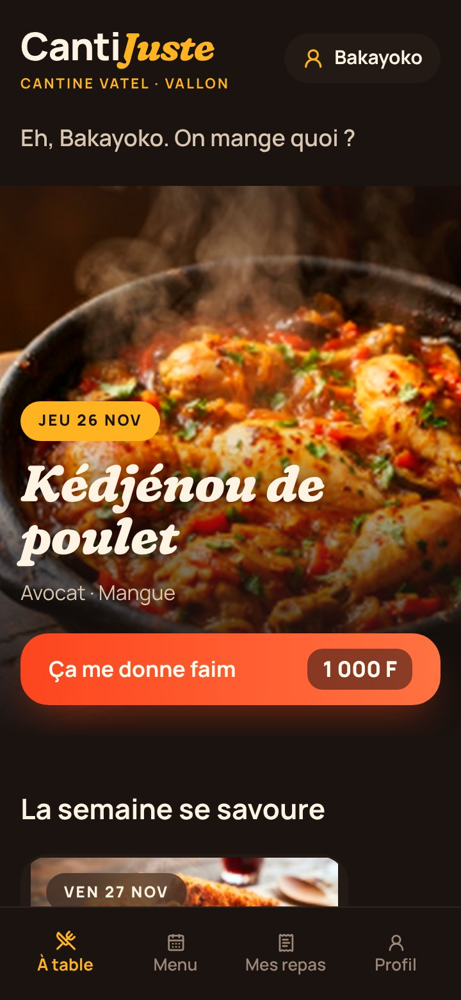
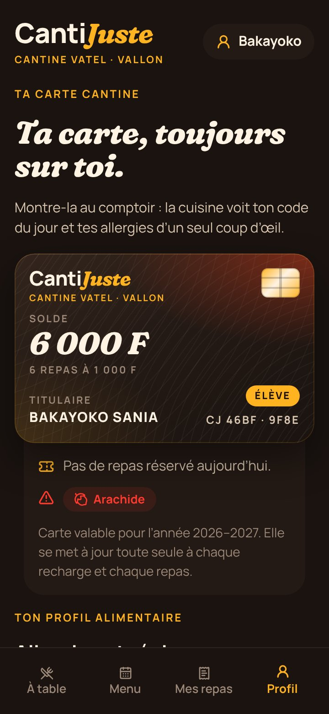
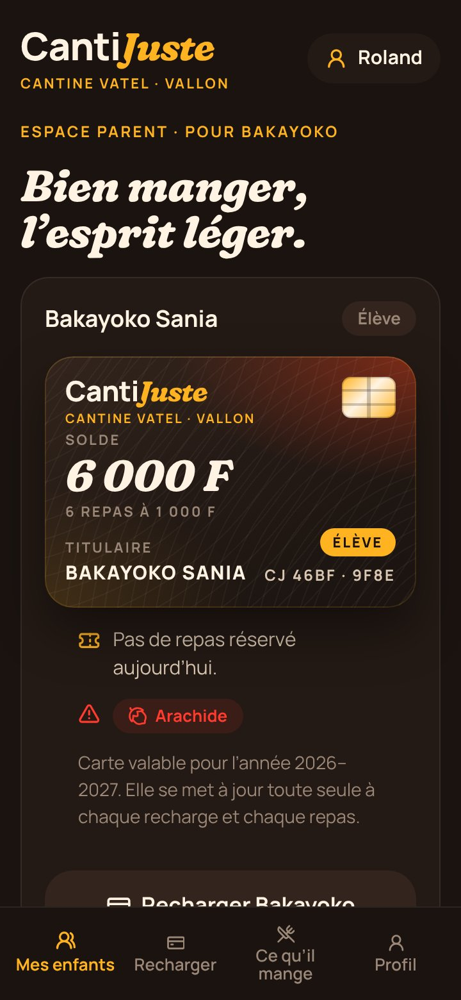
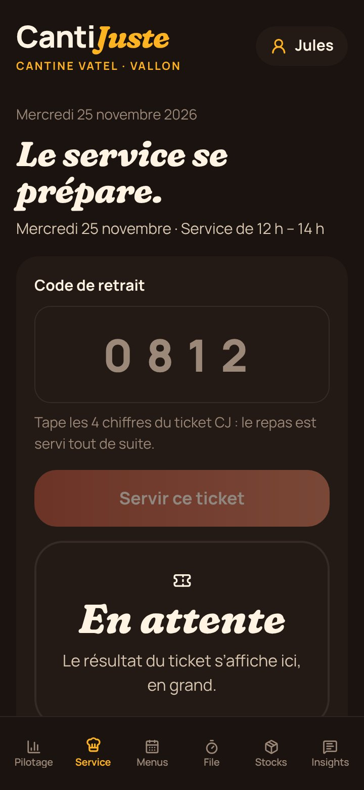
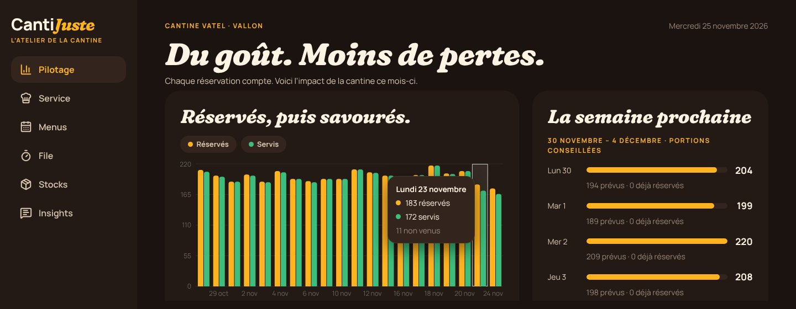

# CantiJuste · la cantine Vatel

> **Le bon repas, pour la bonne personne, en bonne quantité.**

CantiJuste est l'application de la cantine scolaire et d'entreprise « Cantine Vatel · Vallon » (nom d'établissement fictif). Les élèves et les employés réservent leur repas depuis leur téléphone et paient sans espèces, les parents rechargent et suivent ce que mange leur enfant, et la cuisine sait chaque matin combien de repas préparer, pour qui, et avec quelles allergies.

Projet réalisé seul pendant le hackathon « Application de gestion de cantine » du groupe Vatel (novembre 2026).

- **Démo en ligne** : _lien Vercel à coller ici_
- **Comptes de démo** (un clic sur la page de connexion) : `eleve.demo@cantijuste.ci`, `parent.demo@cantijuste.ci`, `admin.demo@cantijuste.ci`, mot de passe `Demo2026!`

| Élève · À table | Élève · carte cantine | Parent · Mes enfants | Admin · comptoir |
| --- | --- | --- | --- |
|  |  |  |  |



---

## Les problèmes du cahier des charges, et notre réponse

| Problème | Ce que fait CantiJuste |
| --- | --- |
| Longues files d'attente | Chaque élève choisit un **créneau de passage** de 10 minutes (« 12 h 10 · Calme ») ; les créneaux pleins se ferment. Côté admin, un **modèle de file d'attente (Markov)** simule le midi : « 17,9 min → 3,6 min » et le nombre de guichets à ouvrir. |
| Gaspillage alimentaire | Réservation au plus tard la veille à 18 h, donc la cuisine connaît le **nombre exact de repas** ; prévision de la semaine suivante, **stocks déduits à chaque repas servi**, chiffre « gaspillage évité » en FCFA. |
| Régimes et allergies | Profil alimentaire (5 allergènes, régime végétarien, sans porc, halal, autre allergie en texte libre). Chaque plat est vérifié : pastille rouge dès l'accueil, **plat de remplacement proposé**, confirmation obligatoire, **alerte envoyée au parent**, liste « À surveiller » en cuisine. |
| Transparence menus et tarifs | Menu de la semaine avec photo, allergènes et **prix affiché sur le bouton** (« Je réserve · 1 000 F » élève, 1 500 F employé). Historique de chaque franc : recharges, repas, remboursements. |
| Gestion manuelle de l'admin | Menus (créer, modifier, dupliquer, copier la semaine, retirer avec remboursement automatique), **comptoir par code de retrait à 4 chiffres**, stocks, **rapport du mois exporté pour Excel**, avis des élèves classés par l'IA. |

## Fonctionnalités

### Élève ou employé (4 onglets)
- **À table** : le prochain repas à réserver, un plat qui lui convient en grand et les autres plats au choix du jour.
- **4 plats au choix chaque jour** (plus entrée, dessert et boisson) : ceux qui vont à son profil passent en premier, un seul repas par jour.
- **Menu** : la semaine du lundi au vendredi, les plats au choix de chaque jour, réservation en 3 touchers, choix du créneau, ticket crème avec le code de retrait « CJ · 0812 ».
- **Mes repas** : solde en direct, tickets à venir (annulables jusqu'à la veille 18 h), repas servis à noter en étoiles, historique des mouvements, recharge Mobile Money.
- **Profil** : **carte cantine virtuelle** (titulaire, tarif, solde, code du jour et allergies d'un seul regard au comptoir), profil alimentaire en une ligne qui ouvre un **formulaire** : allergies écrites librement (étiquettes, les 5 allergènes suivis reconnus même tapés « cacahuètes »), régime proposé ou écrit à la main (« Pas de bœuf »), signalé sur les plats dont le nom le laisse penser. La déconnexion se trouve derrière le prénom, en haut à droite, sur tous les écrans.
- Bandeau **« Solde bas »** sous 2 000 F.

### Parent (3 onglets)
- **Mes enfants** : la carte cantine de chaque enfant, alertes allergie en temps réel, profil alimentaire modifiable, ajouter un enfant avec le **code à 6 caractères qu'il crée dans son Profil** (24 h, un seul usage : sans le téléphone de l'enfant, personne ne peut le suivre), ou le délier.
- **Recharger** : Mobile Money (Wave, Orange Money, MTN MoMo), montants rapides ou libres de 500 à 50 000 F.
- **Ce qu'il mange** : les repas réservés, servis et notés par l'enfant.

### Administrateur (barre latérale sur PC, onglets sur téléphone)
- **Pilotage** : gaspillage évité, repas à préparer demain (marge de 5 %), taux de gaspillage, graphique réservés / servis sur 4 semaines, prévision, plats favoris, crédit manuel d'un compte, **export du rapport d'activité du mois** (CSV pour Excel).
- **Service** : nombre de repas du jour, répartition par plat, grand champ « Code de retrait » pour servir, liste des convives, carte rouge « Allergies à surveiller ».
- **Menus** : semaine en grille, panneau d'édition (plat, remplacement, prix élève / employé, photo, allergènes, contenu viande / porc, recette), dupliquer, retirer, copier vers la semaine suivante.
- **Stocks** : quantité restante, besoin pour demain, jauge, liste de courses, livraisons.
- **Insights** : 500 avis lus et classés par thème et sentiment par l'IA (Claude), résumé de la semaine, file « À revoir » validée par un humain, import et export CSV.
- **File** : simulation du midi, curseur « élèves qui suivent le créneau conseillé », nombre de guichets.

### Bonus du guide
| Bonus | État |
| --- | --- |
| Notation des plats | Fait (étoiles + mot pour la cuisine, analysés dans Insights) |
| IA | Fait côté admin (classement des avis, résumé) ; pas de suggestion de repas personnalisée côté élève |
| Application mobile | Fait : appli web **installable** sur Android et iOS (PWA, icône sur l'écran d'accueil) |
| Mobile Money | Simulé (voir « Limites ») |
| Notifications en temps réel | Fait dans l'appli (solde, alertes allergie, commandes du jour se mettent à jour seuls) ; pas de notification push hors de l'appli |
| Mode hors ligne | Fait : le dernier menu, les tickets et le solde restent visibles sans réseau, avec un bandeau « Hors ligne » |
| Multi-langue | Pas fait : interface en français uniquement |

## Architecture

```
Téléphone / PC ──► React + Vite (PWA, Vercel)
                     │  supabase-js (clé publique, session de l'utilisateur)
                     ▼
                  Supabase
                  ├─ Auth (e-mail + mot de passe)
                  ├─ Postgres + RLS sur chaque table
                  ├─ Fonctions SQL « security definer » pour l'argent et les statuts
                  └─ Temps réel (solde, réservations, alertes, avis)
                     ▲
                  api/analyser-avis.js (fonction serveur Vercel) ──► API Claude (clé côté serveur seulement)
```

```
api/                  fonction serveur Vercel (analyse des avis par l'IA)
public/               icônes de l'appli, photos des plats
src/
  ecrans/             un fichier par écran (ecrans/admin/ pour Stocks, Insights, File)
  composants/         morceaux réutilisables (carte cantine, ticket, badges, fenêtres…)
  lib/                appels à Supabase, formatage des montants et des dates, règles métier
  index.css           tout le design (thème sombre « Appétit »)
supabase/
  schema.sql          la base complète : tables, RLS, fonctions, droits (relançable)
  donnees_*.sql       données de démonstration
  patchs/             l'historique des scripts, déjà inclus dans schema.sql
```

**Stack** : React 19, Vite, JavaScript, CSS sans framework, Supabase, Recharts (graphiques), lucide-react (icônes), vite-plugin-pwa, @anthropic-ai/sdk (côté serveur uniquement), déploiement Vercel.

## Sécurité

- **RLS sur toutes les tables** : chacun ne voit que ses données, un parent seulement ses enfants liés, l'admin tout. Le rôle est lu par `mon_role()` (security definer) pour éviter la récursion.
- **Argent et statuts uniquement par fonctions SQL** (`reserver`, `annuler`, `recharger_mobile_money`, `crediter`, `marquer_servie`, `retirer_menu`…), qui vérifient le rôle, les montants et les délais. Aucune écriture directe possible dans `mouvements` ; le rôle, le solde, le tarif et le profil alimentaire sont verrouillés par un déclencheur.
- Réservation **sous verrou** : deux réservations simultanées ne peuvent pas dépasser le solde.
- **Aucune clé secrète dans le code** : seulement `VITE_SUPABASE_URL` et `VITE_SUPABASE_ANON_KEY` (publiques par conception, protégées par la RLS). La clé de l'API Claude vit dans les variables d'environnement Vercel et n'est lue que par `api/analyser-avis.js`, qui vérifie aussi que l'appelant est admin.

## Lancer le projet

1. **Supabase** : créer un projet, puis dans *SQL Editor* coller `supabase/schema.sql` et l'exécuter. Dans *Authentication > Providers > Email*, désactiver « Confirm email ».
2. **Comptes de démo** : créer les 3 comptes depuis l'écran d'inscription de l'appli, puis exécuter dans l'ordre `donnees_demo.sql`, `historique_demo.sql`, `donnees_menus_semaine.sql` (4 plats au choix par jour), `donnees_file_attente.sql`, `donnees_stocks.sql`, `donnees_avis.sql`. Le matin d'une démo, relancer `donnees_rafraichir_demo.sql` (jours passés servis, ticket CJ · 0812 du jour).
3. **Local** :
   ```bash
   cp .env.example .env      # puis coller l'URL et la clé publique Supabase
   npm install
   npm run dev
   ```
4. **Vercel** : importer le dépôt, ajouter `VITE_SUPABASE_URL`, `VITE_SUPABASE_ANON_KEY` et `ANTHROPIC_API_KEY`, déployer. Sans clé Claude, l'analyse des avis passe en « mode secours » (mots-clés) et tout part dans la file « À revoir ».

## Limites, en toute honnêteté

- **Le paiement Mobile Money est simulé** : l'écran reproduit le parcours (opérateur, numéro, confirmation) et crédite le solde par une fonction SQL sécurisée, sans appel à un vrai opérateur. Le badge « Simulation » l'indique dans l'appli. En production : API d'un agrégateur (CinetPay, Wave Business…) et confirmation par webhook côté serveur.
- Le type de compte (élève ou employé) est déclaré à l'inscription ; en production, il serait validé par l'établissement (liste des inscrits).
- Pas encore d'écran « mot de passe oublié » ni de gestion de l'équipe admin ; un seul établissement.
- Interface en français seulement ; pas de notification push hors de l'appli ; pas de suggestion de repas par l'IA côté élève.
- Les comptes de démo, la connexion en un clic et les fichiers `donnees_*.sql` n'existent que pour la démonstration. Le détail de ce qui est prêt pour une vraie cantine est dans [docs/RAPPORT_AUDIT.md](docs/RAPPORT_AUDIT.md).

## Crédits

Design « Appétit » et maquettes réalisés pour le projet. Photos des plats issues des maquettes du projet. Icônes : Lucide (licence ISC). Polices : Fraunces et Manrope (Google Fonts, licence OFL).
